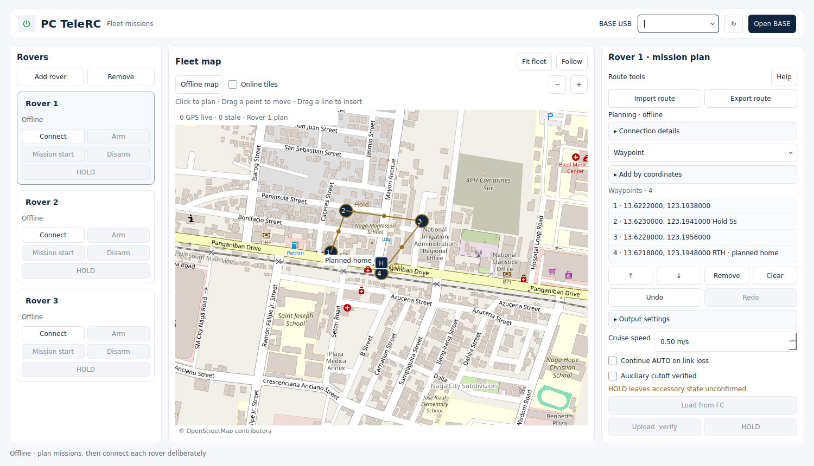
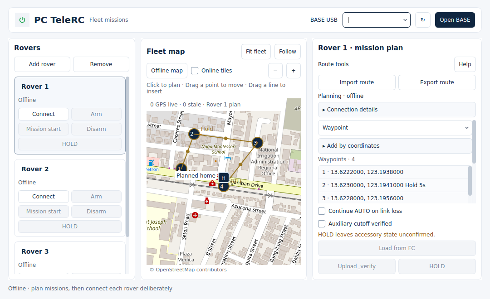

> Historical light-theme proposal. Superseded by the compact dark v1.2.0rc8 design; see [current feature review](FEATURE-REVIEW-rc8.md).

# Aero Academy UI preview

Application-only design update based on published v1.2.0rc7 source
`9e6ed22dd78ce680962a74ba3e69639064cabff0`. Main retains an older application
lineage, so this branch targets `dev/mission-v1.2.0rc7-fc-readback`.
This is an unreleased UI preview, not a replacement v1.2.0rc7 release.

The reference is `Denberg28/Aeronautical-Open-Academy` MainActivity and
WorkspaceActivity: white paper, navy `#102640`, muted `#536174`, fine
`#e4e9f0` borders, restrained typography and rounded panels.

## Changes

- Reusable light theme, original TeleRC power logo, clear header and status footer.
- 280 px roster with two-column actions; selected rover receives a quiet card outline.
- Larger central map with compact fit/follow, map source and zoom tools.
- Connection identifiers/telemetry and manual coordinates expand on demand.
- Output settings remain expandable. Cruise speed has a label.
- Route import/export, safety consent, Upload & verify and HOLD remain outside
  the editor scroll area. Arm, Mission start and Disarm stay on each rover card.
- Light route menu, arrival-hold dialog, terrain fallback, readable rover/home labels,
  and bundled SVG dropdown/check indicators (included in wheel and frozen assets).

## Verification

Linux / Python 3.12.14 / PySide6 6.11.2 / pytest 9.1.1:

| Check | Result |
| --- | --- |
| Isolated full application suite | PASS — 52 modules, 479 checks |
| After final disclosure/caption changes | PASS — 49 targeted UI/route/standalone verifier checks |
| Compileall, pip check, git diff whitespace | PASS |
| Firmware diff against rc7 | PASS — no changes |
| Native Qt renders | Reviewed at 1500×860, 1366×768 and 1080×660 |
| Expanded coordinates/outputs | Reviewed; vertical scrolling, no horizontal clipping |
| Windows/frozen preview | Separate `Aero UI Windows preview` workflow; inspect its result |
| Physical hardware/field validation | NOT TESTED; no control/transport/firmware changes |

Run `PYTHONPATH=src python scripts/run_regressions.py` (Windows does not need
PYTHONPATH after editable installation). A new regression confirms that expanding
and collapsing optional panels preserves the draft and verification digest,
opens no USB session, and leaves status/HOLD accessible.

The Windows workflow runs all regressions, builds the executable and executes the
existing strict frozen fleet verifier. It uploads a commit-named portable UI preview
and evidence only after success; it does not publish or modify releases.
The preview uses the existing rc7 firmware pairing. The version stays 1.2.0rc7 until
this design is assigned its own release; PREVIEW.txt identifies its exact source.

Firmware bytes and pairing configuration are unchanged. Session, freshness,
normal arm/disarm, independent cutoff and one-shot start gates remain intact.
Rollback: use the original published rc7 executable/source; no settings or draft
format migration was introduced.

## Screenshots

These are actual Qt renders with a sample offline draft at the application's
public default map area. Public OpenStreetMap tiles are cached; there are no
connected rovers or simulated live GPS fixes. Attribution remains visible.

